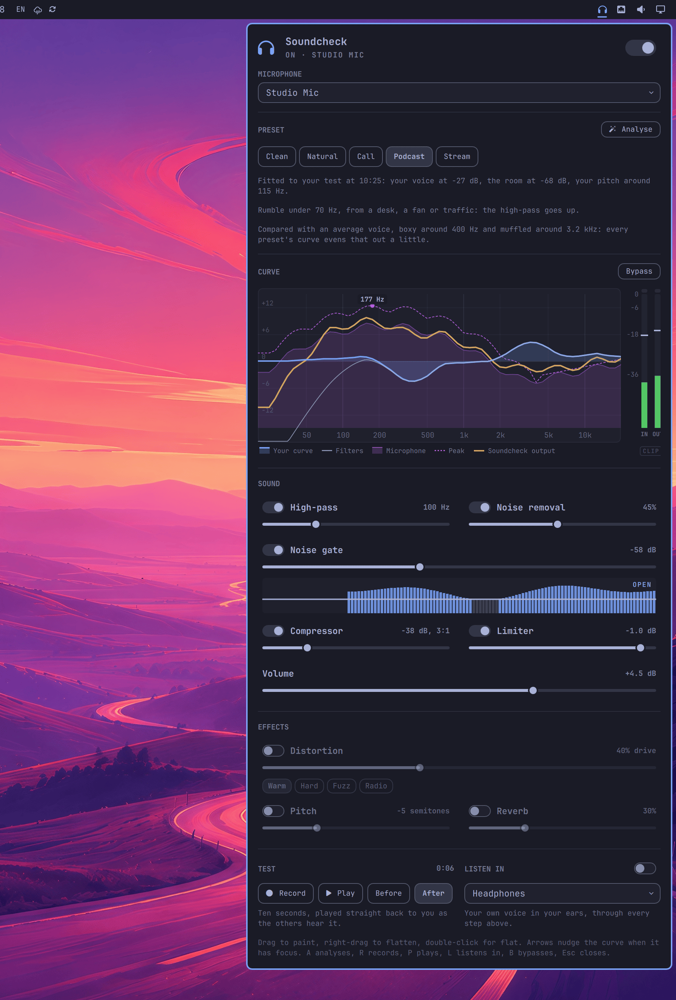
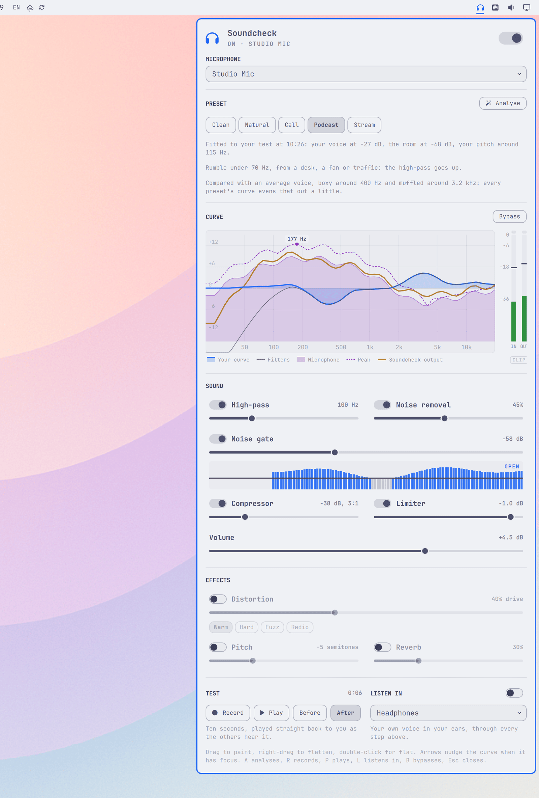

# Soundcheck

Draw the sound of your microphone.

Soundcheck puts a chain in front of your microphone: a curve you paint with the mouse, a noise gate, and when you want them, noise removal, a compressor and a limiter. And for fun: distortion in four kinds, a pitch shifter and a reverb. Every app gets the result, because Soundcheck becomes your default input. Meet, Zoom, Slack, OBS, a browser tab, anything that records.

Not sure where to start? Pick a preset and press **Analyse**: it listens to ten seconds of you and fits the preset to your voice, your microphone and your room.

<p align="center">&nbsp;</p>

And it lets you hear what you did. Record ten seconds and they play back round and round the way the others will hear them, while you keep changing things, with Before and After one click apart. Or listen in: your own voice in your headphones while you paint the curve, through every step.

The bar shows a pair of headphones. Dimmed while Soundcheck is off, in your accent colour while it is on, with a dot beside them while you are listening in (the one state you do not want to forget about), and crossed out in red when the chain should be running and is not.

## Install

Everything in one go, the plugin together with the three packages it can use:

```bash
omarchy pkg add noise-suppression-for-voice lsp-plugins-lv2 rubberband-ladspa && omarchy plugin add https://github.com/jankeesvw/omarchy-soundcheck --enable
```

It asks for your password for the packages, whether you trust the plugin, and where in the bar it goes (on the right unless you pick another place). Then click the headphones and switch it on.

The packages are for four steps only: `noise-suppression-for-voice` for noise removal (RNNoise), `lsp-plugins-lv2` for the compressor and the limiter, `rubberband-ladspa` for the pitch shifter. The curve, the high-pass, the noise gate, distortion, reverb, the volume, the test and listening in are built into PipeWire itself. So the plugin alone works too:

```bash
omarchy plugin add https://github.com/jankeesvw/omarchy-soundcheck --enable
```

The steps that need a package then say which one, and copy the command when you click it. Once a package is there, its step offers to restart the chain. That is a second of silence on the microphone, so do it before a call rather than in one.

## Switching it on

The switch at the top of the panel. It does three things:

1. It starts the chain as a small PipeWire client of its own, under a systemd user service, so it is there again after a reboot.
2. It makes **Soundcheck Microphone** your default input.
3. It moves anything that is already recording over to it. Without this, a call that was running when you switched would keep the bare microphone until you rejoined.

Switching it off does the same in reverse: the microphone you had becomes the default again, recording apps move back to it, and the service is removed.

PipeWire and WirePlumber are never restarted, not when you switch, not when you change something. A restart drops every app's audio connection, and some hardware does not take it well; a webcam that hangs every time you touch your microphone settings is not a trade anyone wants. The way Omarchy runs its own speaker tuning is the way this runs too.

Pick the microphone in the panel. The chain listens to that one microphone and never to "the default", because the default is now the chain itself. Switching microphones moves the chain over without a restart.

## Presets and Analyse

Five presets. Clean is the zero point, the other four are ways of treating a voice:

| Preset | For | What it does |
|---|---|---|
| **Clean** | Hearing your microphone as it is | Every step and every effect off, the curve flat, the volume at 0. The sliders stay where they were, so a step you switch back on comes back the way you had it. |
| **Natural** | A good microphone in a quiet room | A light touch: 2:1 just over your voice and a gentle correction of the curve. In a really quiet room it leaves the gate and noise removal off. |
| **Call** | Meet, Zoom, Slack | Clear rather than full: more low end cut, a little presence around 3 kHz, more noise removal, 2.5:1. |
| **Podcast** | Recording yourself | Warm and even: less boxiness around 300 Hz, presence and air on top, 3:1. |
| **Stream** | Over a game or music | Up front: more presence and air, 4:1, the loudest of the four. |

The four set the curve and everything under Sound, and leave the effects as they are; Clean switches those off as well. **Undo** puts back what you had before, until you close the panel. Move a slider and the preset is no longer lit: what you have then is your own.

What a preset cannot know is your microphone. A gate at -55 dB is right for one microphone at one input volume and wrong for the next, and the same goes for a compressor. That is what **Analyse** is for. It records ten seconds of you talking (talk as you would on a call, with a pause now and then: the pauses measure the room), measures them, fits the preset you chose last (Call if you have not chosen one, or chose Clean, which has nothing to fit) and plays the test back through it.

What it measures, and what follows from it:

- **Your voice.** How loud you talk, measured roughly the way ITU-T P.56 does: over the moments you talk, not over the pauses. The compressor starts a few dB under it, and the volume is set so you leave at the preset's level: about -20 dB for Natural and Call, -18 for Podcast, -16 for Stream.
- **The room.** How loud your pauses are. The gate goes between the room and your softest words, measured the way the gate itself measures, and noise removal goes up the closer the room comes to your voice.
- **Your pitch.** The high-pass goes to just over half of it, so a deep voice keeps its low end. Rumble under 70 Hz sends it up.
- **Your spectrum.** It is compared with the average voice, the long-term speech spectrum of Byrne et al. (1994). Where yours differs by more than a couple of dB, the curve evens part of the difference out, smoothed over an octave and never at your pitch. It lifts nothing where the room is nearly as loud as your voice, because that would lift the room as well.
- **Clipping.** A microphone that clips is set too loud, and nothing after it can repair that. Analyse says so in red, and also when your voice comes in so quiet that turning it up would turn up the room with it.

Every test you record is measured as well, so the presets always fit the last one. A test made on another microphone is not used for this one. The measurement is kept in `~/.config/omarchy-soundcheck/analysis.json`; the recording itself is not.

## Drawing the curve

Drag across the graph and the curve follows the pointer: wherever you go, the curve goes to your height. The brush is soft, about a third of an octave wide, so a quick stroke comes out smooth rather than jagged. Drag with the right button to paint back towards 0 dB, double-click to start over flat.

Behind the curve runs a live spectrum of your microphone while the panel is open: where your voice sits and how loud, twenty times a second. A dotted line over it holds the loudest each frequency has been for the last second or two, and the one that sticks out most gets its frequency written next to it. With Soundcheck on, a line shows what it sends on, so you see a peak go down as you paint over it. The scale follows your microphone, so a quiet one fills the graph as well as a loud one.

That is the point of drawing here rather than turning knobs: the hum is a bump at 50 Hz, the boxiness is a hump around 300, the hiss is a shelf above 8 kHz, a whistle is a spike that keeps its label, and you can paint them out where you see them.

There are two lines on top. The filled one, in your theme's accent colour, is what you painted. The thin one is what the filters actually do, worked out with the same formulas PipeWire runs, so it is what you will hear. They match within a dB; where they part is the high-pass at the bottom end.

Every line has a colour of its own, and the legend under the graph names them. The microphone and the output get two colours picked to stand apart from your accent, so on a blue theme the microphone is violet and the output amber, and neither is ever mistaken for the curve.

Beside the graph sit two level bars: **IN** is your microphone, **OUT** what Soundcheck sends on. Green is room to spare, yellow is loud, red is close to the top, and the tick above each bar is the peak. When a peak hits full scale, the lamp on top of that bar and **CLIP** under both light up for two seconds. On IN that means the microphone itself is set too loud, which nothing after it can repair: turn its gain down. On OUT it means the chain made it too loud for the app: turn the volume down, or switch on the limiter.

Under the graph sit 30 filters, one every third of an octave from 25 Hz to 20 kHz. Neighbouring filters overlap, so their boosts add up: setting each one to the height you painted would overshoot by several dB. Soundcheck solves all thirty together instead, so the sum lands on your curve.

Every change is heard straight away, while you drag. Nothing restarts and nothing clicks, so you can do this during a call.

**Bypass**, above the graph, switches everything to neutral for as long as you hold it on, so you can hear the difference live. It never touches what you saved. For a curve to start from, pick a preset; for a flat one, double-click the graph.

## The sound

What makes your voice clean, in the order it goes through:

| Step | What it is for | Starts at |
|---|---|---|
| **High-pass** | Rumble, pops, the desk being bumped. Everything below the frequency is cut. | 80 Hz |
| **Noise removal** | RNNoise, a small neural network that keeps voices and drops fans, keyboards and traffic. The slider is how sure it must be that you are talking. Needs `noise-suppression-for-voice`. | 50% |
| **Noise gate** | Silence between your sentences: shut 3 dB under the threshold, fully open 3 dB over it, opening at once and letting go gently. Under the slider runs a strip of the last six seconds: how loud your microphone was, with the threshold drawn across it. What got through is in your accent colour, what the gate held back is grey, so you can put the threshold between the room and your voice and watch it work. | -55 dB |
| **Curve** | What you painted. | flat |
| **Compressor** | Evens out loud and quiet. The slider is the threshold, the ratio is 3:1, and half of what it takes away at full level is given back, so switching it on makes you more even rather than quieter. Needs `lsp-plugins-lv2`. | -24 dB |
| **Limiter** | A ceiling nothing goes past, for the laugh that would otherwise clip. Needs `lsp-plugins-lv2`. | -1 dB |
| **Volume** | The level of the whole thing, for when the curve took a lot away or added a lot. | 0 dB |

## Effects

For fun rather than for a clean voice, and all three off until you switch them on. They sit where they sound best in that chain: pitch and distortion right after the curve, so the compressor evens out what they make, and the reverb just before the limiter, so its tail is not squeezed but still never goes past the ceiling.

| Effect | What it does | Starts at |
|---|---|---|
| **Distortion** | Grit, in four kinds. **Warm** rounds the top of your voice off softly, **Hard** cuts it flat and buzzes, **Fuzz** drives it off centre so the two halves of the wave break up differently and quiet words sputter, **Radio** squeezes you into the telephone band and overdrives that. The slider is the drive; the loudness stays about where it was, so it changes the grit and not the volume. Switching kinds is instant. | Warm, 40% |
| **Pitch** | Your voice up or down, a semitone at a time and up to an octave either way, through Rubber Band's live shifter, the one made for low latency. It adds a little delay while it is on and none while it is off, and keeps running in the background once installed, at a few percent of one core. Needs `rubberband-ladspa`. | -5 semitones |
| **Reverb** | A room around your voice: made up, about a second long, and the same room every time. The slider is how much of it you hear. | 30% |

## Testing it

**Record** takes up to ten seconds; press it again to stop sooner. It records your bare microphone and plays it straight back through the chain, round and round until you press Stop.

While it plays, change anything: paint the curve, move the gate, switch a step on or off. You hear it on the next word, because After is not a recording of how it sounded then but your recording going through a preview of the chain right now. The graph and the gate's strip follow the recording while it plays, so you see what you hear. The preview is a chain of its own that plays on the output you listen in on and never reaches an app, so this works with Soundcheck switched off as well.

**Before** plays the recording as it is. Switching while it plays starts the other one from the top, so you compare the same sentence.

While a test plays, listening in pauses, or you would hear yourself twice.

The recording lives in `$XDG_RUNTIME_DIR/omarchy-soundcheck/`, which is memory, not disk. The next test replaces it and logging out removes it.

## Listening in

Switch on **Listen in** and you hear yourself in your headphones, through every step: what the others get. Handy while you paint the curve, and for some people during calls as well.

It picks the first output that is a pair of headphones. Pick a speaker instead and the panel warns you, because the speakers will feed back into the microphone.

Listening in stays on when you close the panel; the dot beside the headphones in the bar reminds you. It never switches itself on, also not after a restart of the shell, so you will not suddenly hear yourself out of nowhere.

## Keys

Everything works without a mouse. Tab walks the controls. On the graph, Left and Right pick a frequency, Up and Down raise or lower it by half a dB (Shift for 3 dB), 0 sets it back to zero and F makes the curve flat. On a step, Space switches it and Left and Right move its slider; on Distortion, Up and Down pick the kind.

Anywhere in the panel: **A** analyses, **R** records, **P** plays, **L** listens in, **B** bypasses and **Esc** closes. The presets are one stop for Tab; Left and Right walk them and Enter picks one.

## Command line

The panel runs a small helper that lives inside the plugin:

```bash
~/.config/omarchy/plugins/jankeesvw.soundcheck/bin/soundcheck status
```

```bash
soundcheck status                      # everything the panel shows, as JSON
soundcheck on | off                    # what the switch does
soundcheck reload                      # rebuild the chain after installing a package
soundcheck mic <node name>             # listen to another microphone
soundcheck save '<settings json>'      # store settings and apply them
soundcheck analyse                     # measure the last test, fit the presets to it
soundcheck render                      # the PipeWire config "on" would write
soundcheck demo on | off               # invented devices and curve, for screenshots
```

## What it writes

- `~/.config/omarchy-soundcheck/settings.json`: your curve and the settings of every step.
- `~/.config/omarchy-soundcheck/state.json`: the microphone to give back when you switch off, and which packages the running chain was built with.
- `~/.config/omarchy-soundcheck/pipewire.conf`: the chain, only while Soundcheck is on.
- `~/.config/omarchy-soundcheck/reverb.wav`: the room the reverb plays, written the first time it is needed.
- `~/.config/omarchy-soundcheck/analysis.json`: what the last test measured (levels, pitch and spectrum, no sound).
- `~/.config/systemd/user/omarchy-soundcheck.service`: the service that runs it, only while Soundcheck is on.
- `$XDG_RUNTIME_DIR/omarchy-soundcheck/`: the last test recording, and the preview's config while one plays, in memory.

The directory is private to you (0700, files 0600) and every file is written to a temporary name first and then moved into place, so a half-written settings file cannot happen.

Nothing goes over the network. The microphone is opened by the chain only while something records from Soundcheck Microphone, and by the panel only while the panel is open, for the meter.

## If something is not working

**The bar shows a crossed-out red microphone.** The service should be running and the microphone it provides is gone. `systemctl --user status omarchy-soundcheck` says why. Switching off and on again in the panel rebuilds it.

**The panel says apps use another input.** Something set the default input back to your bare microphone, often the input list in Omarchy's own audio panel. Switch Soundcheck off and on to take over again, or pick Soundcheck Microphone in that list.

**A step says it needs a package that is installed.** Click **Restart chain** under it. A chain is built with what was installed when it started. The same button shows up after an update that adds something to the chain, such as new kinds of distortion.

**The meter under the gate does not move.** It shows the microphone picked in the panel. Check that it is the one you are talking into.

**You hear an echo of yourself.** Listening in is on. The dot beside the headphones in the bar says so.

## Removing it

Switch Soundcheck off first, in the panel or with `soundcheck off`. That gives your microphone back and removes the service. Then:

```bash
omarchy plugin remove jankeesvw.soundcheck
rm -r ~/.config/omarchy-soundcheck
```

The second line takes your curve and settings with it.

Removed the plugin while Soundcheck was still on? The service keeps running without it, so take it out by hand and pick your microphone again in Omarchy's audio panel:

```bash
systemctl --user disable --now omarchy-soundcheck.service
rm ~/.config/systemd/user/omarchy-soundcheck.service
systemctl --user daemon-reload
```

The packages for noise removal, the compressor and the pitch shifter stay installed: other things may use them. `omarchy pkg drop noise-suppression-for-voice lsp-plugins-lv2 rubberband-ladspa` removes them.

## Credit

The filters are the ones from Robert Bristow-Johnson's [Audio EQ Cookbook](https://www.w3.org/TR/audio-eq-cookbook/), which PipeWire's built-in filters implement too. Noise removal is [RNNoise](https://github.com/xiph/rnnoise) by Jean-Marc Valin, as packaged by [werman/noise-suppression-for-voice](https://github.com/werman/noise-suppression-for-voice). The compressor and limiter are from [LSP Plugins](https://lsp-plug.in). The pitch shifter is the [Rubber Band Library](https://breakfastquay.com/rubberband/) by Particular Programs.

None of them has anything to do with this one.

## Licence

MIT.

The devices and the curve in the screenshots come from the plugin's demo mode (`soundcheck demo on`), shot in a clean Omarchy VM on its stock wallpapers.
